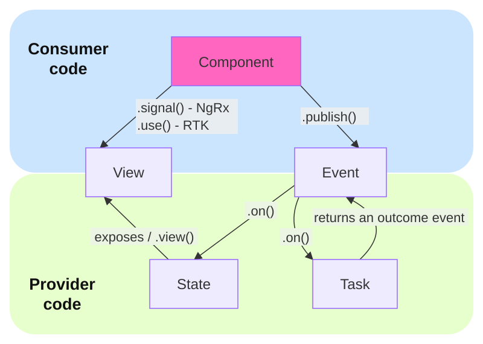

# EVST

**Event, View, State, Task**

A minimalist, event-driven programming model for applications using the Redux
pattern, with implementations for Angular/NgRx and React/Redux Toolkit.

| Package               | Integration                              | Guide                                            |
| --------------------- | ---------------------------------------- | ------------------------------------------------ |
| `@evst/ngrx-store`    | Angular, NgRx Store and Effects          | [NgRx README](packages/ngrx/README.md)           |
| `@evst/rtk`           | React, Redux Toolkit and React Redux     | [RTK README](packages/rtk/README.md)             |
| `@evst/eslint-plugin` | Shared conventions and framework presets | [ESLint guide](packages/eslint-plugin/README.md) |

- [Understanding the rationale](#understanding-the-rationale)
- [Understanding the programming model](#understanding-the-programming-model)
- [Enforcing event-driven programming](#enforcing-event-driven-programming)
- [Choosing an implementation](#choosing-an-implementation)
- [Exploring the Books examples](#exploring-the-books-examples)
- [Developing the workspace](#developing-the-workspace)

## Understanding the rationale

The Redux pattern is event-driven at its core, but its APIs also allow
command-shaped actions that coordinate a particular response. EVST makes an
event-driven style explicit: events describe what happened, while State and
Task decide how the application responds.

Reducers, selectors, side effects, and component interactions are usually
introduced through separate APIs. Their relationships are assembled across
files, which can make a feature harder to navigate and its behavior harder
to follow. EVST connects these primitives around four objects: Event, View,
State, and Task.

A Books page, for example, publishes an `entered` event. State can respond by
showing a loading indicator, while a Task loads books and returns a `loaded`
or `loadFailed` outcome event. The component describes what happened without
coordinating those responses. Read-only Views expose the resulting state for
rendering.

Each implementation retains its underlying store and ecosystem. The package
guides cover the concrete APIs, registration, integration, and testing.

## Understanding the programming model

Events and Views connect consumer code with provider code. Components publish
Events to describe what happened and read Views to render state. Provider code
declares how State and Task subscribe to those Events and which Views expose the
resulting state. Components do not need to know which handlers respond.



| Object    | Role                                                                        |
| --------- | --------------------------------------------------------------------------- |
| **Event** | Describes something that happened and belongs to its source.                |
| **View**  | Exposes a read-only projection of state to consumer code.                   |
| **State** | Subscribes to events through pure state handlers and exposes Views.         |
| **Task**  | Subscribes to events, performs side effects, and can return outcome events. |

“Consumer” and “provider” describe programming roles here. They do not refer
specifically to Angular dependency injection or React's Provider component.

Events are grouped by their source, using names such as `fromBooksPage` and
`fromBooksApi`. Event names describe what happened, such as `entered`,
`bookSelected`, or `loaded`. The source owns publication; States and Tasks
independently define their responses.

A **View** is a read-only projection of underlying state: it exposes a stored
value or derives a value from other Views. The term refers to a data view, not
a UI component, template, or screen. Views describe how state is read, not how
it is displayed. Components, Tasks, and other application logic can consume Views;
state changes belong in event-driven state handlers.

State exposes Views
for its top-level fields, and `.view()` and `view()` compose derived
Views. Components consume them through `.signal()` in NgRx or `.use()` in RTK.

Events are published; both adapters declare state handlers with
`.state((on) => ({ ... }))` and optional feature Tasks with
`.task((on, views) => ({ ... }))`. Standalone Tasks use `task()`.
State handlers perform pure transitions; Tasks perform side effects and can
return outcome events.

`evst(name, initialState)` creates an immutable feature definition. Every
`.view()`, `.state()`, and `.task()` call returns a new composable definition;
all three may be repeated. Tasks receive the Views declared before their callback.
Standalone `task()` defines independent tasks, while standalone `view()` can
compose Views from different features. Duplicate view names, handler labels,
and state-event subscriptions within one feature throw during composition.

Registration activates subscriptions through NgRx environment providers or
RTK's positional `createEvstStore(booksEvst, authEvst, otherTasks, options?)`
and `store.provide(...definitions)`. Underlying store registration semantics are
preserved. Subscription lifetimes follow that registration.

## Enforcing event-driven programming

Event-driven programming is a usage discipline, not a philosophical label.
Event-driven programming depends on how events are used: sources report what
happened, and States and Tasks independently decide how to respond.

### Comparing events and commands

The central distinction is ownership and intent. An event belongs to the source
where something happened. A command addresses a target responsible for
performing requested work.

| Aspect                      | Event                                 | Command                                 |
| --------------------------- | ------------------------------------- | --------------------------------------- |
| Meaning                     | Describes what happened               | Requests work                           |
| Logical owner               | Source                                | Handler                                 |
| Responses                   | Zero or more independent handlers     | One intended logical handler            |
| What the caller knows       | What happened                         | What work it wants done                 |
| Expectation                 | “This happened; react if needed.”     | “Please do this work.”                  |
| EVST publication convention | One authoritative publishing boundary | May be dispatched from multiple callers |
| Example                     | `fromBooksPage.entered`               | `loadBooks`                             |

One authoritative publishing boundary is an EVST convention, rather than a
universal requirement of event systems. The event-versus-command distinction
depends on meaning and ownership, not simply on using a past-tense name.
Publishing events in sequence to coordinate particular responses introduces
command-style coordination.

### Applying the rules

These rules preserve EVST's event-driven programming model: sources publish what
happened, while States and Tasks independently determine how to respond.

- An event has one publishing boundary owned by its source.
- An executable boundary publishes one event rather than a sequence of events
  that coordinates work.
- Each State defines at most one handler for a given event. Multiple States and
  Tasks can respond to the same event.
- Tasks return outcome events instead of publishing follow-up events directly.
- Components consume Views and publish events without coordinating handlers.

### Checking conventions with ESLint

`@evst/eslint-plugin` checks these conventions through a shared `core` preset
and complete `evst-ngrx` and `rtk` presets under the same `evst/` rule namespace.
Shared checks cover source naming, explicit publisher ownership, sequential
publication, duplicate state handlers, and unused events and derived Views.

The NgRx preset adds Angular View-subscription and Task-source checks.
Static analysis does not prove every convention: for example, returned Task
outcomes are recognized by usage analysis but are not checked for publisher
ownership. Configuration and limitations are documented in the
[ESLint guide](packages/eslint-plugin/README.md).

## Choosing an implementation

EVST provides a consistent programming interface across NgRx and Redux Toolkit.
Both implementations organize features around Event, View, State, and Task,
while preserving framework-specific integrations such as Angular Signals,
RxJS Observables, and React hooks.

The following table summarizes how each implementation integrates with its framework:

| Concern           | `@evst/ngrx-store`                          | `@evst/rtk`                                               |
| ----------------- | ------------------------------------------- | --------------------------------------------------------- |
| Component Views   | Angular Signals; Observables also available | React Redux hooks                                         |
| State transitions | Immutable NgRx reducers                     | RTK reducers with Immer support                           |
| Tasks             | NgRx Effects and RxJS pipelines             | RTK listener middleware and sync/async handlers           |
| Store setup       | `provideEvstStore()` and feature providers  | `createEvstStore()` returns an RTK store with `provide()` |
| Event publication | `.publish()`                                | `.publish()`                                              |

The [NgRx guide](packages/ngrx/README.md) and
[RTK guide](packages/rtk/README.md) each walk through a Books feature,
including setup, consumer code, registration, linting, and tests.

## Migrating existing definitions

This API replaces the previous names immediately; compatibility aliases are not
retained.

| Previous API                               | Current API                                      |
| ------------------------------------------ | ------------------------------------------------ |
| `state(name, initialState)`                | `evst(name, initialState)`                       |
| `.extraViews(...)`                         | `.view(...)`                                     |
| `.stateOn(...)`                            | `.state(...)`                                    |
| `.taskOn(...)`                             | `.task(...)`, with further composition supported |
| Standalone `taskOn(...)` or `tasks(...)`   | `task(...)`                                      |
| Angular feature `.on(event, handler)`      | `.state(on => ({ label: on(event, handler) }))`  |
| `FeatureStateDefinition` / `FeatureBundle` | `EvstDefinition`                                 |

RTK registration takes positional definitions and an optional final options
object: `createEvstStore(booksEvst, otherTasks, { devTools: false })`.
Lazy registration uses `store.provide(booksEvst, otherTasks)`. NgRx registration
continues to use environment providers. Standalone `view()` remains available
for composing Views across features.

## Exploring the Books examples

The [Books overview](example.md) describes the example applications.

- [EVST NgRx Books](examples/projects/evst-ngrx-books) can be compared with
  [NgRx Books](examples/projects/ngrx-books) and its
  [standalone version](examples/projects/ngrx-books-standalone).
- [EVST RTK Books](examples/projects/evst-rtk-books) can be compared with
  [RTK Books](examples/projects/rtk-books), using the same React UI and feature
  behavior.

## Developing the workspace

Commands run from the private npm workspace root:

```sh
npm install
npm run build
npm test
```

Individual packages can be checked independently:

```sh
npm test --workspace @evst/ngrx-store
npm test --workspace @evst/rtk
npm test --workspace @evst/eslint-plugin
npm run lint:evst-ngrx-books
npm run lint:evst-rtk-books
```

`npm run docs:api` generates the NgRx API reference at
`packages/ngrx/docs/api/index.html`. `npm run pack:all` creates installable
archives for the workspace packages.

EVST is MIT-licensed; see the [license](LICENSE). The
[third-party notices](NOTICE) acknowledge the NgRx Books examples.
